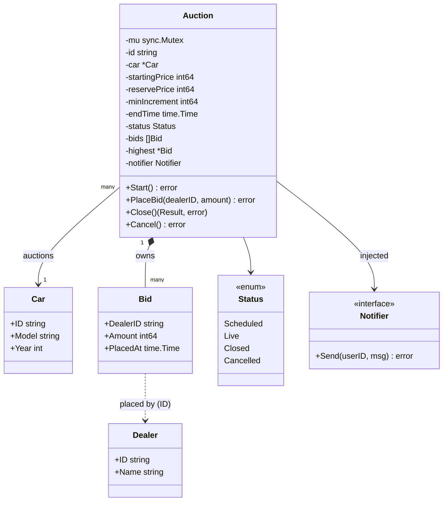
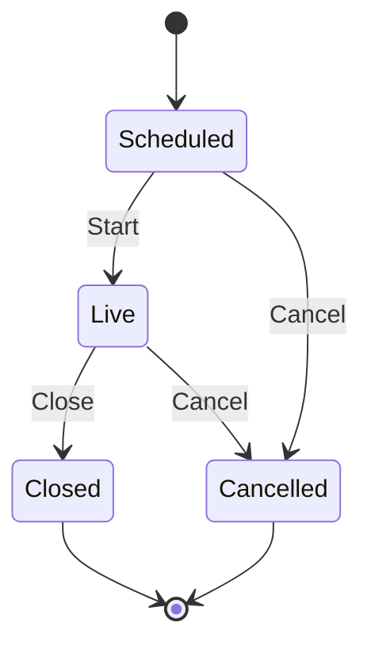

# Car Auction System

**Difficulty:** Medium · **Focus:** State, Observer-style notifications, dependency injection, concurrency

Dealers bid on used cars listed by an admin. This is the kind of question Cars24 asks:
small surface, but it tests lifecycle rules, money handling and concurrent writes.

---

## Requirements

**Functional**
1. An admin creates an auction for a car with a starting price, a reserve price, a minimum
   increment and a duration. The admin can cancel it.
2. The auction starts, runs for the duration, then closes.
3. A dealer can bid while it's live. A bid must be at least the starting price (first bid)
   or beat the current highest by the minimum increment. A dealer can't outbid themselves.
4. On close, the highest bidder wins if their bid reached the reserve price; otherwise the
   car is unsold.
5. Notify a dealer when they're outbid, and the winner when the auction closes.

**Non-functional**
- Correct under concurrency: two simultaneous bids can never both become the highest.
- Adding a notification channel must not change auction code.

**Out of scope:** payments, auth, real SMS/email providers, persistence.

---

## Class diagram



| Relationship | Kind | Why |
|---|---|---|
| Auction → Bid | composition, 1-to-many | bids don't exist without their auction |
| Auction → Car | association, many-to-1 | an unsold car can be re-auctioned |
| Bid → Dealer | by ID only | a bid needs *who*, not a copy of the dealer |
| Auction → Notifier | dependency, injected | swap SMS/email/push without touching Auction |

## Lifecycle



All legal moves live in one map in `status.go`; every status change goes through
`transition()`. Closing twice or bidding on a scheduled auction returns an error.

---

## Design decisions

- **Money is `int64` rupees, never `float`.** Floats can't represent amounts exactly.
- **`highest` is cached**, so validating a bid is O(1) instead of scanning all bids.
- **One mutex per auction.** Check-then-update in `PlaceBid` is atomic; different auctions
  never block each other. `TestConcurrentBidsOneWinner` fires 50 identical bids at once and
  asserts exactly one is accepted (run with `-race`).
- **Notifications are sent after unlocking**, so a slow SMS provider never blocks bidders.
- **The clock is injected** (`Config.Now`), so tests move time without sleeping.
- **Sentinel errors** (`ErrBidTooLow`, `ErrNotLive`, …) let callers use `errors.Is`.

| File | Responsibility |
|---|---|
| `entities.go` | `Car`, `Dealer`, `Bid`, `Result`: plain data |
| `status.go` | `Status` enum and the allowed-transitions map |
| `notifier.go` | `Notifier` interface + a no-op implementation |
| `auction.go` | Rules: lifecycle, bid validation, winner selection |
| `errors.go` | Sentinel errors |

## Try it

```go
a, err := auction.NewAuction(auction.Config{
    ID:            "A1",
    Car:           &auction.Car{ID: "C1", Model: "Swift", Year: 2019},
    StartingPrice: 3_00_000,
    ReservePrice:  4_00_000,
    MinIncrement:  1_000,
    Duration:      30 * time.Minute,
})
if err != nil {
    log.Fatal(err)
}

_ = a.Start()
_ = a.PlaceBid("dealer-1", 3_00_000)
_ = a.PlaceBid("dealer-2", 4_10_000) // dealer-1 gets an "outbid" notification

res, _ := a.Close()
fmt.Println(res.Sold, res.WinnerID, res.Amount) // true dealer-2 410000
```

```bash
go test -race ./problems/auction/ -v
```

---

## Follow-ups (the interviewer will ask these)

- **Anti-sniping:** a bid in the last 2 minutes extends `endTime` by 2 minutes. One `if` in `PlaceBid`.
- **Auto-close at end time:** a scheduler (or `time.AfterFunc`) calls `Close()` at `endTime`.
- **More reactions on close** (start payment, analytics): replace the single `Notifier` with a list
  of listeners (Observer), or publish an event to Kafka with idempotent consumers.
- **Pluggable bid rules** (percentage increments, dealer tiers): a `BidRule` interface (Strategy).
- **Multiple app servers:** the in-memory mutex no longer helps; use a DB row lock or a
  version column (optimistic locking) on the auction row.

## Status

- [x] Requirements and class diagram
- [x] Lifecycle with enforced transitions
- [x] Bid validation and winner selection
- [x] Concurrent-safe bidding
- [x] Tests passing
- [ ] Follow-up: anti-sniping
- [ ] Follow-up: auto-close at end time
